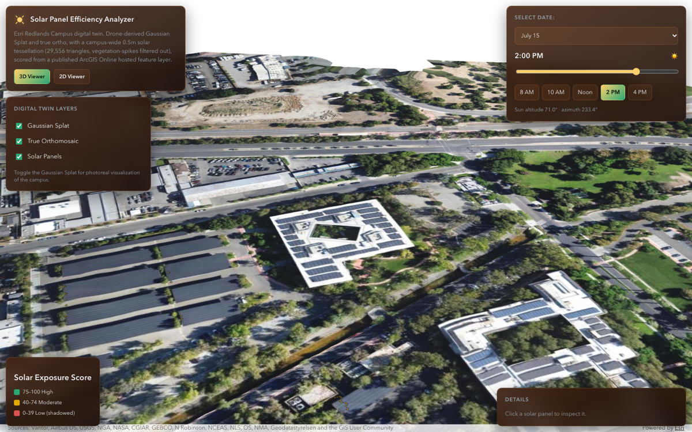
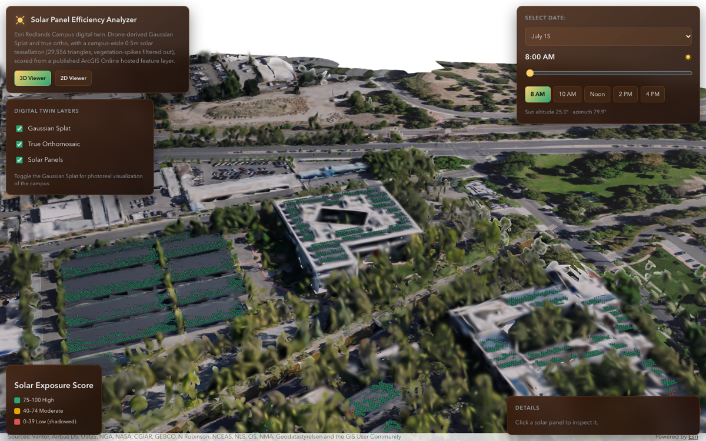
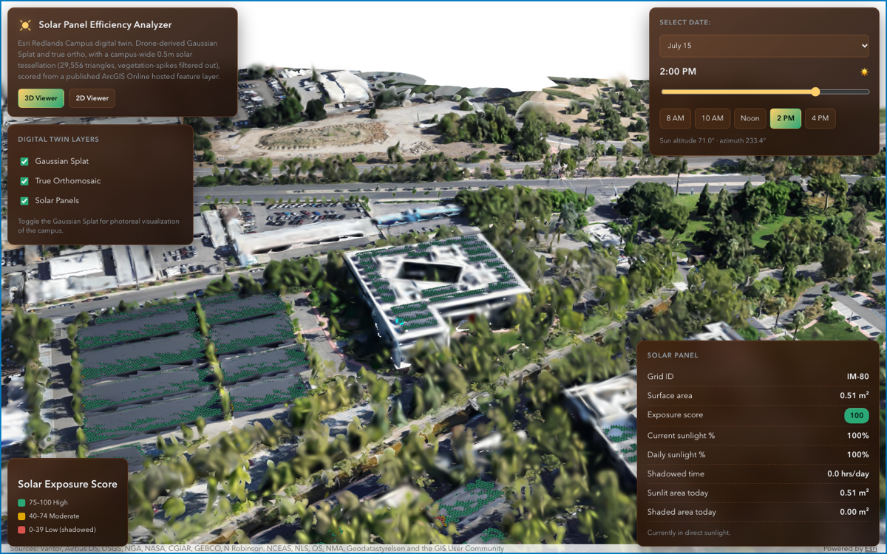
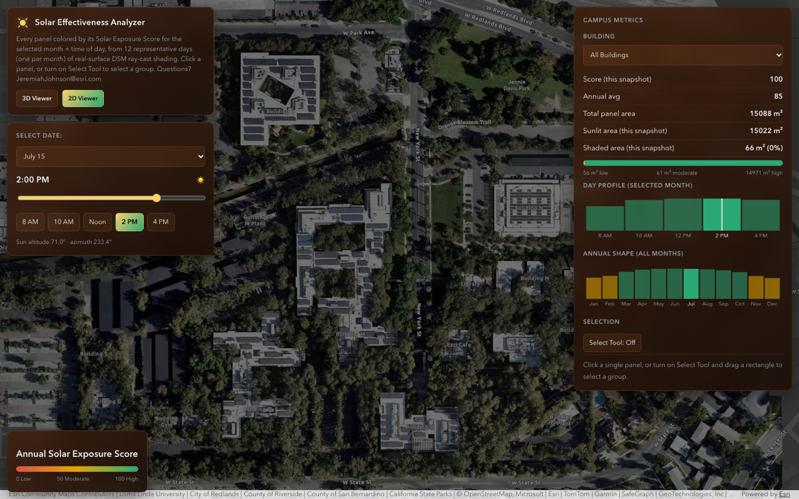
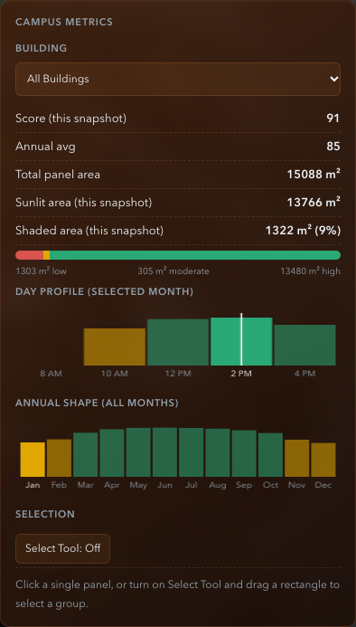
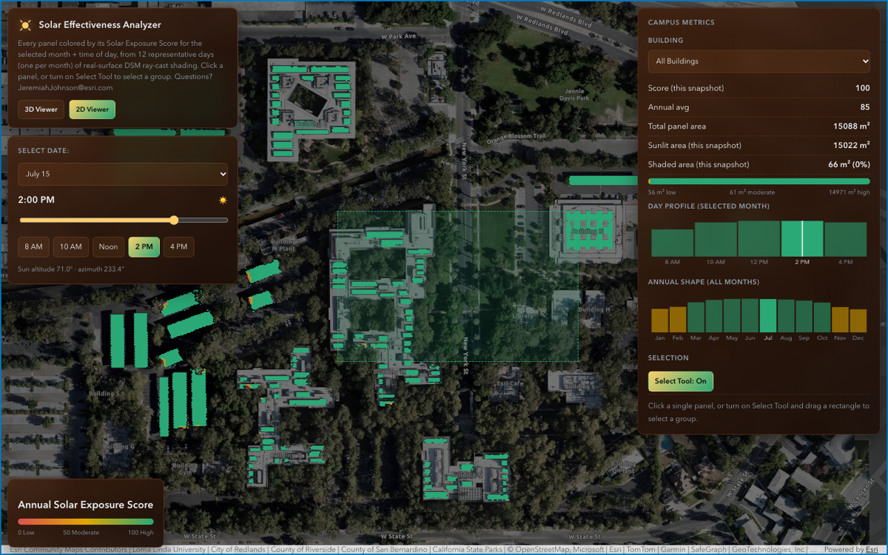

# ArcGIS Solar Panel Efficiency Analyzer

An interactive campus digital twin for the Esri Redlands campus (Building E)
that shows **how much direct sunlight every rooftop solar panel is getting,
for any time of day across the year** — driven entirely by real, hosted
ArcGIS Online data. The app ships as two companion viewers:

- **3D Viewer** (`index.html`) — a photorealistic Gaussian Splat of the
  campus with a live-shaded solar-panel layer draped over it.
- **2D Viewer** (`2DViewer.html`) — a flat, orthomosaic-based heatmap of the
  same panels, built for fast campus-wide comparison, charting, and
  selection.

Both pages read panel geometry and precomputed exposure scores from the same
hosted AGOL feature service — there are no local data files or client-side
shadow simulation involved.

## What it does

- **Month + time-of-day controls** — pick one of 12 representative days
  (the 15th of each month) and one of 5 snapshot times (8 AM, 10 AM, Noon,
  2 PM, 4 PM). Every panel recolors instantly to that exact snapshot's
  exposure score, applied to the whole layer in a single batched
  `applyEdits()` call (no per-panel redraws, no renderer rebuild).
- **0–100 Solar Exposure Score** per panel per snapshot, precomputed offline
  from a DSM ray-cast shadow analysis (see [How the data was built](#how-the-data-was-built)
  below) and published as 60 fields (`S_01_08` … `S_12_16`) on the hosted
  feature service.
- **Sun position readout** — altitude/azimuth and a day/night indicator for
  the selected month + time, computed client-side from the campus
  lat/lon (purely informational; it does not drive the shading itself).
- **Panel click-for-details (3D Viewer)** — click any panel to see its Grid
  ID, true 3D surface area, current exposure score, daily sunlight %,
  shadowed hours/day, and sunlit vs. shaded area, all in m² (no assumed
  wattage — see [Why everything is area-based, not kWh](#why-everything-is-area-based-not-kwh)).
- **Drag-select with a live bounding-box overlay (2D Viewer)** — toggle
  "Select Tool: On" and drag a rectangle over the map; a dashed selection
  box follows the cursor in real time (a pure visual overlay — it never
  affects the map's extent or zoom), and on release every panel inside the
  box is selected and summarized.
- **Building selector (2D Viewer)** — a dropdown of distinct values from the
  service's `Building` attribute (still being populated upstream), so you
  can isolate a specific building's panels instead of drag-selecting.
- **Day-profile + annual-shape charts (2D Viewer)** — the metrics panel
  shows (a) the 5 snapshot-hour scores for the *currently selected month*
  and (b) the annual, weighted monthly average across all 12 months.
  Both charts are clickable — clicking a bar/point jumps the app to that
  time/month, exactly as if you'd used the slider or the month dropdown.
- **Dual snapshot vs. annual metrics (2D Viewer)** — the metrics panel
  always shows both the current snapshot's numbers and a separate,
  always-visible annual average, so you can compare "right now" against
  the full-year picture at a glance.
- **Layer toggles (3D Viewer)** — independently show/hide the Gaussian
  Splat, the true orthomosaic, and the solar panel layer.

## Datasets that power it

All data is read live from ArcGIS Online, organization `uujCiiEZAflDbdxE`
(`services1.arcgis.com/uujCiiEZAflDbdxE`). See `js/data-sources.js` for the
exact item IDs and URLs.

| Dataset | What it is | How it was made |
|---|---|---|
| **Gaussian Splat** (item `7f185e5b93cf42b79345b049e5b7bf45`) | Photorealistic 3D point-cloud/splat reconstruction of the campus (Spexi Redlands capture), rendered in the 3D Viewer as the base scene. | Drone photogrammetry capture processed into a Gaussian Splat scene layer. |
| **True Orthomosaic** (`RedlandsCampus_Spexicapture_Orthomosaic` tiled image service) | Flat, geometrically corrected aerial imagery, used as the base map/texture for both viewers (desaturated/dimmed under the heatmap in the 2D Viewer). | Published from the same Spexi drone capture. |
| **`SolarPanelAnnualExposureScores_v2`** (`FEATURE_SERVICES.solarPanelsAnnual`) | The campus-wide, vegetation-spike-filtered solar panel tessellation (~29,556 triangles) with true 3D geometry, surface area, and 60 precomputed `S_<MM>_<HH>` exposure-score fields (12 months × 5 times of day), plus a `Building` text field. **This is the single source of truth for panel geometry and scores used by *both* the 3D and 2D viewers.** An earlier, separate non-`_v2` feature layer was tried for the 2D viewer and has been abandoned in favor of this shared `_v2` service. | Generated offline from a Digital Surface Model (DSM) ray-cast shadow analysis — see below. |

Two other items are declared in `js/data-sources.js` (`Esri_BuildingE_Trees`,
`Building_E_Footprint`, and an integrated-mesh scene item) but are **not
currently rendered or used by either viewer** — they're reserved for
possible future features and are called out here so this README doesn't
overclaim what the app does today.

### How the data was built

The `elevation/`, `detection/`, and `publish/` folders alongside this app
(not part of the deployed web app, and excluded from this repo) contain the
offline Python pipeline that produced the hosted feature service:

1. Drone capture → photogrammetry → Gaussian Splat + Digital Surface Model.
2. `enrich_elevation.py` drapes true elevation onto the 0.5 m solar
   tessellation; `filter_tessellation_spikes.py` removes vegetation-induced
   geometry spikes.
3. `raycast_shadows_annual.py` ray-casts against the DSM for 12 representative
   days × 5 times of day per panel triangle.
4. `build_annual_exposure_fields.py` rolls those results into the 60
   `S_<MM>_<HH>` score fields.
5. The result is published as `SolarPanelAnnualExposureScores.gdb.zip` and
   hosted as the `_v2` feature service both viewers query live.

### Why everything is area-based, not kWh

There are no real panel spec sheets (wattage, nameplate efficiency, inverter
losses) for this array, so a kWh/energy-production number would be an
unverifiable guess dressed up as a measurement. Every metric in this app is
instead area-based: each panel triangle's true 3D surface area (measured
from the DSM-enriched geometry) is split into sunlit vs. shaded portions
using its real, ray-cast exposure score — so "12.4 m² sunlit" literally means
12.4 m² of panel surface was in direct sun, with no assumed watts/m²
anywhere in the calculation.

## Architecture / config

- **`config.production.js`** — tracked in git, loaded first by both HTML
  pages. Holds a public ArcGIS API key that is HTTP-referrer-restricted to
  the GitHub Pages origin (and localhost, for local testing). This is the
  key that powers the live, deployed site.
- **`config.js`** — gitignored, loaded second (and only if present), so it
  overrides `config.production.js` for local development with your own
  key. It 404s harmlessly on GitHub Pages, where it isn't deployed.
- **`config.example.js`** — tracked template showing the expected shape of
  `config.js`.

Both `index.html` and `2DViewer.html` are static pages that load the ArcGIS
Maps SDK for JavaScript from a CDN and query the hosted AGOL feature service
directly from the browser — there's no backend server, build step, or local
data dependency for the deployed app.

## Screenshots

**3D Viewer** — Gaussian Splat campus with the live solar-panel layer:



**3D Viewer, 8 AM** — same panel layer, recolored by the time-of-day control
(longer shadows, lower exposure scores vs. the 2 PM view above):



**3D Viewer panel detail** — clicking a panel shows its real Grid ID, area,
score, and sunlit/shaded breakdown:



**2D Viewer** — campus-wide heatmap, metrics panel, and charts:



**2D Viewer charts** — day-profile (per-hour) and annual-shape (per-month)
charts, both clickable to jump the app to that time/month:



**2D Viewer drag-select** — dragging a live bounding-box overlay to select
panels, without affecting the map view underneath:



## Getting started / local development

This is a static app with no build step.

1. Clone the repo.
2. Copy the config template and add your own ArcGIS API key:
   ```bash
   cp config.example.js config.js
   ```
   Edit `config.js` and set `window.ARCGIS_CONFIG = { apiKey: "<your key>" };`.
   Your key needs access to the `uujCiiEZAflDbdxE` org's hosted services
   listed above.
3. Serve the folder with any static file server, e.g.:
   ```bash
   python3 -m http.server 8080
   ```
4. Open `http://localhost:8080/index.html` (3D Viewer) or
   `http://localhost:8080/2DViewer.html` (2D Viewer).

Note: `data/`, `detection/`, `elevation/`, and `publish/` are intentionally
excluded from this repository (gitignored) — they're the offline
data-processing pipeline described above, not part of the deployed app.

## Credit

This app began as a proof-of-concept exploring what's possible once a
campus has been captured as a photorealistic Gaussian Splat: pairing that
3D digital twin with a real, DSM-derived solar exposure analysis so you can
see — not estimate — how sunlight moves across a campus's rooftop panels
throughout the day and year.
